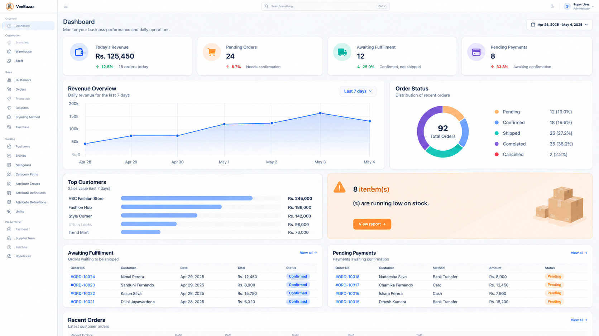

# VeeBazaa – E-commerce Admin Panel

A modern, responsive e-commerce administration panel built with **Angular 21**, **PrimeNG**, and **Tailwind CSS**. VeeBazaa provides a centralized interface for managing e-commerce operations, monitoring business performance, and analyzing sales activities.

<p align="center">
  <strong>VeeBazaa</strong><br/>
  <em>E-commerce Administration Platform</em>
</p>

---

## Dashboard Preview



*Business dashboard featuring sales analytics, revenue trends, order management, and operational insights.*

---

## Overview

VeeBazaa is an e-commerce administration application designed to simplify day-to-day business operations through an intuitive and data-driven interface.

The application provides tools for managing products, inventory, customers, orders, procurement, and organizational resources, alongside a business dashboard for monitoring key performance indicators.

## Features

### Business Dashboard
- Real-time business summary and KPI cards.
- Today's revenue and order statistics.
- Pending orders and fulfillment monitoring.
- Pending payment tracking.
- Revenue trend visualization.
- Order status distribution.
- Top customer sales analysis.
- Recent orders overview.
- Low-stock notifications.

### Organization Management
- Branch management.
- Warehouse management.
- Staff management.

### Sales Management
- Customer management.
- Order management.
- Promotions and coupons.
- Shipping methods.
- Tax classes.

### Product Catalog
- Product management.
- Brand management.
- Category management.
- Category paths.
- Attribute groups.
- Attribute definitions.
- Unit management.

### Procurement
- Supplier management.
- Purchase orders.
- Goods receipts.
- Payment terms.

### Inventory Management
- Inventory monitoring.
- Stock adjustments.
- Stock transfers.

### Access Control
- Role management.
- Module management.
- Permission management.
- Permission-based navigation support.

### User Interface
- Responsive administration layout.
- Collapsible sidebar navigation.
- Global navigation bar.
- User profile menu.
- Light and dark theme integration.
- Reusable UI components.
- Consistent enterprise-style design.

---

## Technology Stack

| Technology | Purpose |
|---|---|
| Angular 21 | Frontend framework |
| TypeScript 5.9 | Application development |
| PrimeNG 21 | UI component library |
| PrimeIcons 8 | Icon library |
| Tailwind CSS 4 | Utility-first styling |
| Chart.js 4 | Data visualization |
| RxJS 7 | Reactive programming |
| Angular Signals | Reactive state management |
| Angular Router | Application navigation |
| Angular CDK | UI infrastructure |

### Development Tools

- Angular CLI
- npm 11
- TypeScript
- Prettier
- Vitest
- jsdom

---

## Getting Started

### Prerequisites

Make sure you have the following installed:

- Node.js (compatible with Angular 21)
- npm 11 or compatible npm version
- Git

### Installation

**1. Clone the repository**

```bash
git clone <repository-url>
```

**2. Navigate to the project directory**

```bash
cd client
```

**3. Install dependencies**

```bash
npm install
```

**4. Start the development server**

```bash
npm start
```

Open your browser:

```text
http://localhost:4200
```

---

## Available Scripts

| Command | Description |
|---|---|
| `npm start` | Start Angular development server |
| `npm run build` | Build production application |
| `npm run watch` | Build and watch for changes |
| `npm test` | Run unit tests |
| `npm run ng` | Execute Angular CLI commands |

### Production Build

```bash
npm run build
```

The production build output is generated in the `dist/` directory.

---

## Project Structure

The application follows a feature-oriented architecture.

```text
client/
│
├── public/
│
├── src/
│   ├── app/
│   │   ├── core/
│   │   │
│   │   ├── features/
│   │   │   ├── dashboard/
│   │   │   ├── sales/
│   │   │   ├── product/
│   │   │   ├── inventory/
│   │   │   ├── procurement/
│   │   │   ├── organization/
│   │   │   ├── rbac/
│   │   │   └── report/
│   │   │
│   │   ├── layout/
│   │   │   ├── navbar/
│   │   │   └── sidebar/
│   │   │
│   │   └── app.routes.ts
│   │
│   ├── environments/
│   ├── styles/
│   ├── index.html
│   └── main.ts
│
├── docs/
│   └── images/
│       └── dashboard.png
│
├── angular.json
├── package.json
├── package-lock.json
├── tsconfig.json
└── README.md
```

*The structure above illustrates the intended organization; actual folder names may vary depending on the implementation.*

---

## Dashboard Analytics

VeeBazaa uses Chart.js to visualize business performance.

Current dashboard visualizations include:

- **Revenue Overview:** Daily revenue trends.
- **Order Status:** Doughnut chart showing order distribution.
- **Top Customers:** Horizontal bar chart showing customer sales.

Additional analytics can be integrated through backend aggregation endpoints.

---

## Application Architecture

The frontend uses Angular standalone components and a feature-based structure.

Key architectural concepts:

- Standalone Angular components.
- Dependency injection using `inject()`.
- Angular Signals for reactive state.
- Angular Router for navigation.
- Service-based API communication.
- Reusable UI components.
- Feature-oriented module organization.

---

## Future Enhancements

- Advanced sales analytics and reporting.
- Monthly and yearly revenue comparisons.
- Payment method analytics.
- Best-selling product reports.
- Advanced inventory analytics.
- Global application search.
- Notification center.
- Exportable business reports.
- Enhanced dashboard date filtering.

---

## License

This project is currently maintained as a private project.

License and distribution terms can be defined when the project is released publicly.

---

<p align="center">
  <strong>VeeBazaa</strong><br/>
  Modern tools for smarter e-commerce management.
</p>